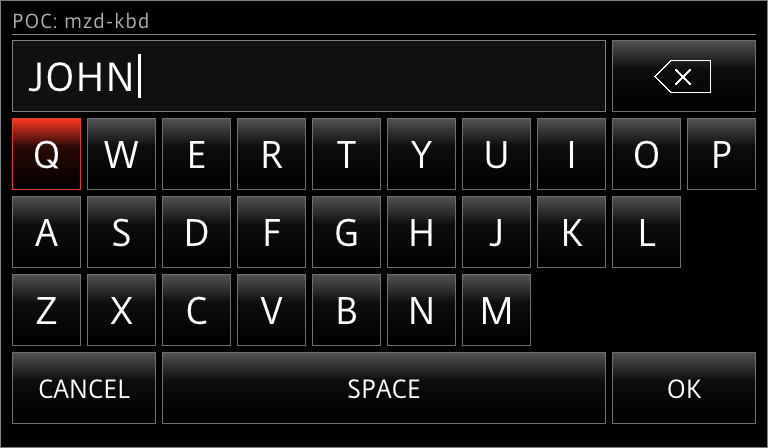

# mzdkbd - on-screen keyboard for the Mazda CMU (POC)

A small static ARM binary that shows a Latin on-screen keyboard (upper case only for POC), lets the user type
with the commander knob, touch or a USB keyboard, and **prints the typed text to stdout**.
It never reads or writes files - the calling `sh` script does that.



The window is 768x448 with a 16 px margin on every side (the stock UI stays visible around it).
While it is open the knob devices are grabbed exclusively, so the stock UI does not react;
the kernel releases the grab when the process ends, whatever the reason.

## How to run

1. Download the repository contents.
2. Copy all files to the **root** of a FAT32 USB drive (keep the `mzdkbd` folder as it is).
3. Turn the ignition to ACC and wait until the CMU has fully started.
4. Plug the drive into the car's USB port. After 2-3 seconds the **POC keyboard** window appears:
   "Click keyboard button and type your name." with the buttons **Keyboard** and **Exit**.
5. Touch **Keyboard** button. The on-screen keyboard opens (the stock UI does not react to the knob while it is open).
6. Type your name - rotate or tilt the knob to move the focus, press the knob (or touch a key) to type -
   then choose **OK**. The keyboard closes. (**CANCEL** or the Home button closes it without saving.)
7. The **Hello, YOUR NAME** window appears. Touch **Exit**.
8. The last window says that you can remove the USB drive. It closes by itself after 10 seconds, or touch **Close**.
   **Do not pull the drive out before this window.**

Touching **Exit** in the first window skips the keyboard and goes straight to the last window.
The dialog windows (`jci-dialog`) work by touch only; the knob works inside the keyboard.

### What you get on the USB drive

| File | Content |
| --- | --- |
| `userdata.txt` | the name you typed (one line, overwritten on every run). Not created if you cancel |
| `logs/mzdkbd-poc/progress.log` | one line per step with the time and the return codes - the quickest way to see how far the script got |
| `logs/mzdkbd-poc/mzdkbd.log` | error messages of the keyboard (normally empty) |

Nothing is written to the head unit itself: the binary is copied to `/tmp` and removed at the end.

## Result

| What | Value |
| --- | --- |
| stdout | the typed text plus a newline, **only on OK** (`$(...)` strips the newline) |
| exit code `0` | OK was pressed |
| exit code `1` | Cancel (CANCEL key, Home, USB Esc) - nothing is printed |
| exit code `254` | `--timeout` / `--max-seconds` expired - nothing is printed |
| exit code `255` | could not start (no Wayland / IVI) - nothing is printed |

Logs (`-v`) go to stderr, so stdout is always clean.

## Controls

| Input | Action |
| --- | --- |
| rotate knob | focus to the next / previous key, all keys in reading order (wraps) |
| tilt left / right | focus to the neighbour key in the same row (stops at the edge) |
| tilt up / down | focus to the key in the row above / below in the same column (a shorter row: its last key) |
| press knob | press the focused key |
| Back | delete the last character |
| Home | cancel |
| touch | press a key |
| USB keyboard | letters (typed upper case), Space, Backspace, Enter = OK, Esc = Cancel |


## Parameters

All are optional, `--name=value` form.

| Parameter | Default | Meaning |
| --- | --- | --- |
| `--value=TEXT` | empty | initial text. Lower case is turned into upper case; only `A-Z` and space are kept |
| `--max-chars=N` | `20` | maximum length (1..100); further keys are ignored |
| `--ok-label=S` | `OK` | label of the OK key |
| `--cancel-label=S` | `CANCEL` | label of the Cancel key |
| `--timeout=SEC` | `0` (none) | close with exit code 254 after SEC seconds |
| `--max-seconds=SEC` | `900` | hard safety cap for the input grab, exit code 254. Keep it set |
| `-v` | off | verbose log on stderr (every key event and the typed text, so do not use it for secrets) |

## Examples

Ask for a name, 20 characters at most:

```sh
NAME=$(/tmp/mzdkbd)
RC=$?
```

Shorter limit, own labels, start with a suggestion, close by itself after 2 minutes:

```sh
NAME=$(/tmp/mzdkbd --max-chars=12 --ok-label=Save --cancel-label=Back --value=John --timeout=120)
RC=$?
```

Typical use in a script - the script decides what happens after each button:

```sh
NAME=$(/tmp/mzdkbd --max-chars=20)
case $? in
  0)   echo "$NAME" > "$MYDIR/userdata.txt"           # OK; $NAME contains only A-Z and spaces
       /jci/tools/jci-dialog --info --title="POC Keyboard" --text="Hello, $NAME" --no-cancel ;;
  1)   : ;;                                           # Cancel / Home
  254) : ;;                                           # timeout
  *)   /jci/tools/jci-dialog --info --title="POC" --text="Keyboard failed to start" --no-cancel ;;
esac
```

A complete example is `mzdkbd-poc.sh` (stock `jci-dialog` windows around the keyboard).
Only one window may be open at a time: start the next one after the previous process has ended.
Never run it without `--max-seconds` (the default 900 is fine) on the car - it holds the knob grab.

